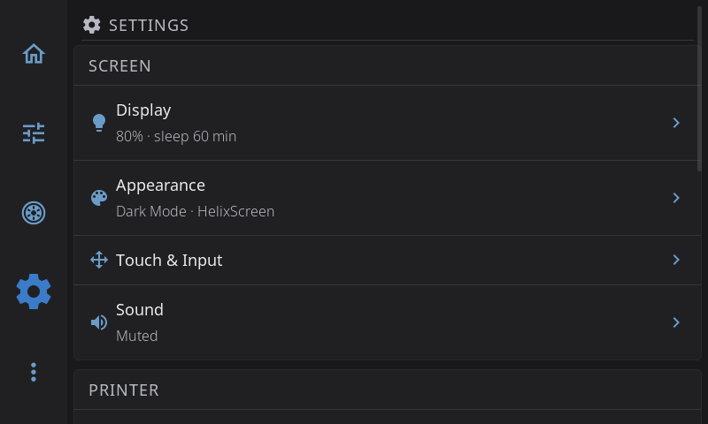
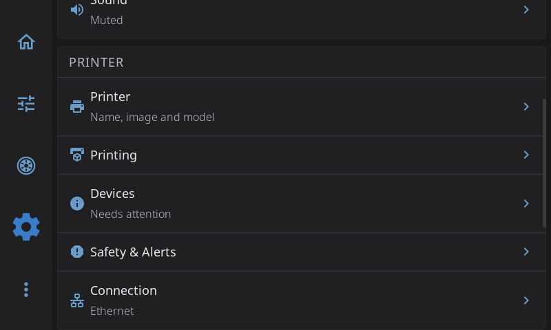
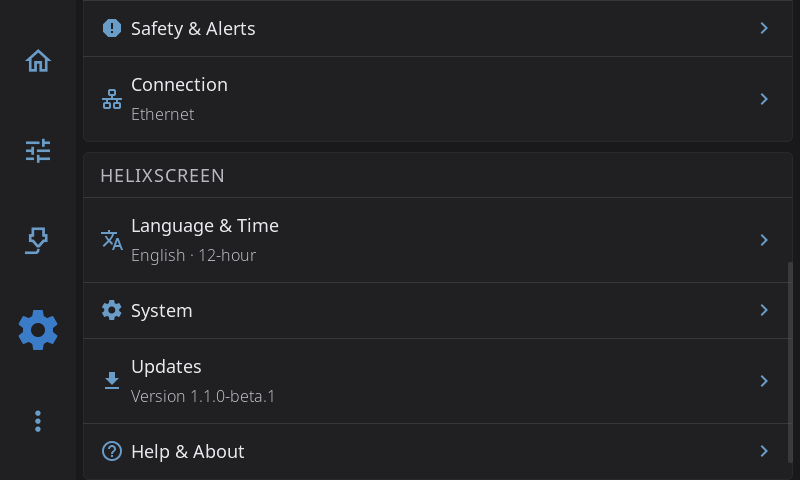

Tap the **gear icon** in the navigation bar to open Settings. It's a single list of pages in three groups (**SCREEN**, **PRINTER** and **HELIXSCREEN**), and every page is one tap away.

## The three groups

**Screen** is about the touchscreen you're holding: how it looks, how it reacts to your finger, and how it sounds.

| Page | What's in it |
|------|--------------|
| [Display](/1.2/guide/settings/display/) | Screen rotation, UI scale, brightness, screen dim, display sleep, screensaver, sleep while printing |
| [Appearance](/1.2/guide/settings/appearance/) | Dark mode, color themes and the theme editor, Glass Effects, animations, widget labels, and how the printer is drawn (toolhead picture, G-code preview, Z labels, bed mesh view) |
| [Touch & Input](/1.2/guide/settings/touch-input/) | Touch calibration, touch points, scroll and long-press feel, home screen editing, scroll buttons, and on Android the keyboard and navigation bar |
| [Sound](/1.2/guide/settings/sound/) | Sounds on or off, volume, button sounds, sound theme, output device, sound preview. Only shown when HelixScreen finds a speaker or buzzer |

**Printer** is about the printer the screen drives and the hardware around it.

| Page | What's in it |
|------|--------------|
| [Printer](/1.2/guide/home-panel/#printer-manager) | Opens the Printer Manager: the printer's name, its picture, the model HelixScreen recorded, software versions, detected hardware, and Manage Printers. The same screen opens when you tap the printer picture on the Home screen |
| [Printing](/1.2/guide/settings/printing/) | Machine limits, motion, retraction, enclosure, filament system, Spoolman (with spool switching, label printer and barcode scanner), material temperatures, cold load and unload, cooling the nozzle after a filament change, confirming tool changes, timelapse, macro buttons |
| [Devices](/1.2/guide/settings/devices/) | Hardware health, camera, print photos, fans, sensors, [LED settings](/1.2/guide/settings/led-settings/), power devices |
| [Safety & Alerts](/1.2/guide/settings/safety/) | E-Stop confirmation, cancel escalation, macro confirmation, spaghetti detection, Bed Clear Check, holding slicer prints that do not fit, print completion alert, on-screen alerts |
| [Connection](/1.2/guide/settings/connection/) | Wi-Fi and Ethernet, your printers, the Moonraker address, the API key, Screen Sharing |

**HelixScreen** is about the app itself.

| Page | What's in it |
|------|--------------|
| [Language & Time](/1.2/guide/settings/language-time/) | Language, timezone, 12 or 24-hour clock |
| [System](/1.2/guide/settings/system/) | Screen lock PIN, storage, performance, usage data, log level, restart, factory reset |
| [Updates](/1.2/guide/settings/updates/) | Update channel, checking for and installing updates. Shows a note instead when your firmware handles updates. Hidden when this install has update checks turned off |
| **Plugins** | The plugins loaded into HelixScreen. This row only appears when at least one plugin is loaded, so most installs never show it |
| [Help & About](/1.2/guide/settings/help-about/) | Welcome tour, debug bundles, Discord, documentation, and About (versions, system details, print hours) |

## Status lines

Some rows show a short line under their name, so you can check things without opening the page. The lines refresh every time you come back to the Settings screen.

| Row | What the line shows | Examples |
|-----|---------------------|----------|
| **Display** | Brightness and when the screen sleeps | *80% · sleep 60 min*, *80% · never sleeps*, *Sleep 60 min* (screens without brightness control) |
| **Appearance** | Light or dark, and your theme | *Dark Mode · Nord* |
| **Sound** | Your volume, or *Muted* when sounds are off or the volume is 0 | *Volume 60%*, *Muted* |
| **Devices** | A hardware health check | *All healthy*, *Needs attention*, *Problem found* |
| **Connection** | How the screen is connected. Ethernet wins when both are up | *Wi-Fi HomeNet*, *Ethernet*, *Not connected* |
| **Language & Time** | Your language and clock | *English · 24-hour* |
| **Updates** | Whether an update is waiting | *Up to date*, *1.1.1 available*, *Checking…*, *Check failed*, *Version 1.1.0*, *Managed by firmware* |

Touch & Input, Printing, Safety & Alerts, System, Plugins and Help & About have no status line. **Printer** always reads *Name, image and model*, a reminder of what it opens rather than a status.

## Where did it go?

If you're coming from HelixScreen 1.0, Settings used to have six categories. Everything is still there and keeps its value; this is where each part moved.

| In 1.0 | Now |
|--------|-----|
| Display & Sound: brightness, dim, sleep, screensaver, rotation, UI scale | [Display](/1.2/guide/settings/display/) |
| Display & Sound: dark mode, theme colors, animations, widget labels, bed mesh render | [Appearance](/1.2/guide/settings/appearance/) |
| Display & Sound: sounds, volume, sound theme | [Sound](/1.2/guide/settings/sound/) |
| Display & Sound: language, timezone, time format | [Language & Time](/1.2/guide/settings/language-time/) |
| Display & Sound: scroll buttons, system keyboard, keep navigation bar | [Touch & Input](/1.2/guide/settings/touch-input/) |
| Printing: toolhead style, G-code preview | [Appearance > Printer Visuals](/1.2/guide/settings/appearance/#printer-visuals) |
| Printing: Z movement (now **Z Buttons Move**) | [Printing > Motion](/1.2/guide/motion/#motion-settings) |
| Hardware & Devices | [Devices](/1.2/guide/settings/devices/) |
| Hardware & Devices > Printers | [Connection > Printers](/1.2/guide/settings/connection/#printers) |
| Safety & Notifications | [Safety & Alerts](/1.2/guide/settings/safety/) |
| Safety & Notifications: allow cold load/unload, cool nozzle after filament ops | [Printing](/1.2/guide/settings/printing/#allow-cold-loadunload) |
| System > Network Settings, System > Host | [Connection](/1.2/guide/settings/connection/) |
| System > Touch & Input | [Touch & Input](/1.2/guide/settings/touch-input/), now straight from the Settings screen |
| Help & About > About: update channel, check for updates | [Updates](/1.2/guide/settings/updates/) |

---

**Next:** [Advanced Features](/1.2/guide/advanced/) | **Prev:** [Calibration & Tuning](/1.2/guide/calibration/) | [Back to User Guide](/1.2/guide/)
