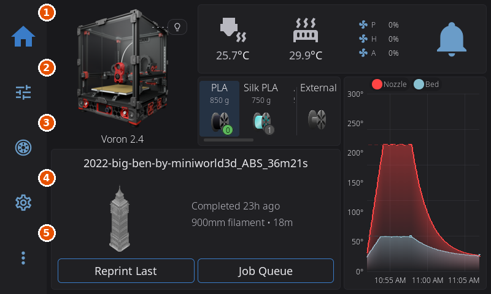
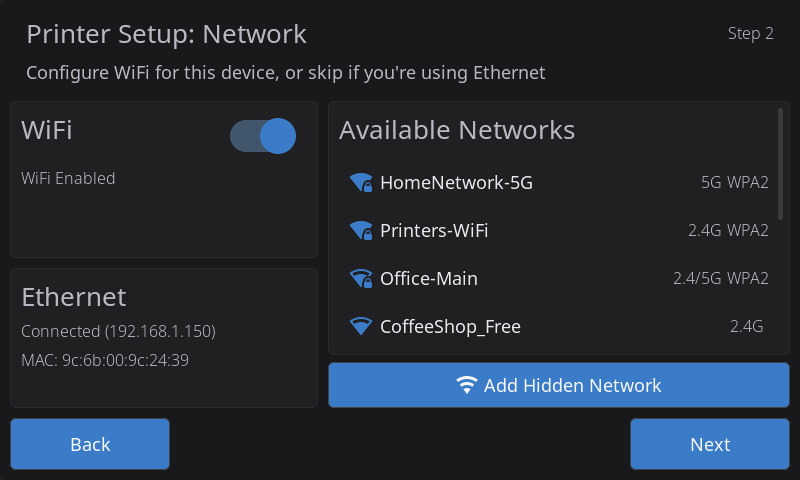
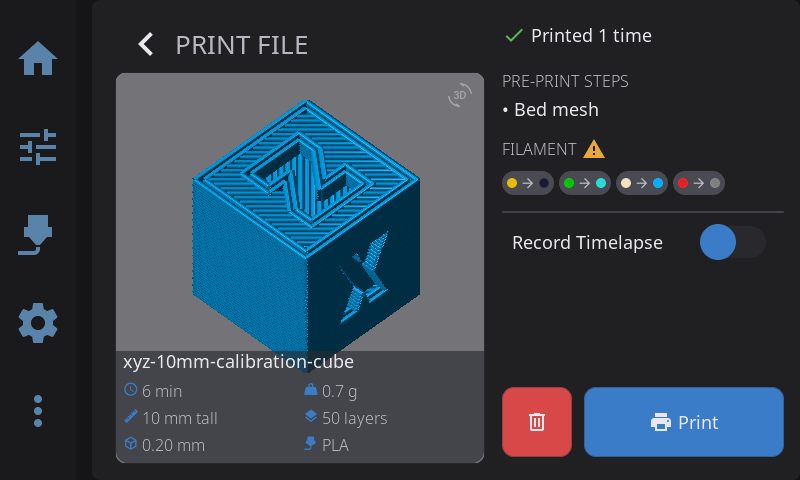
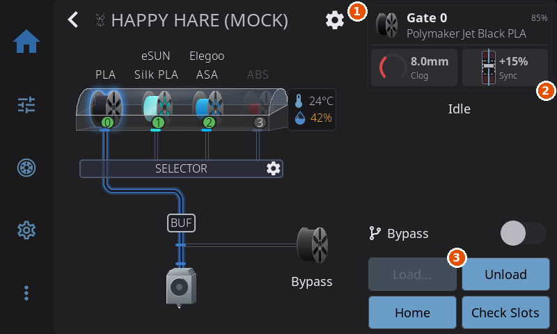
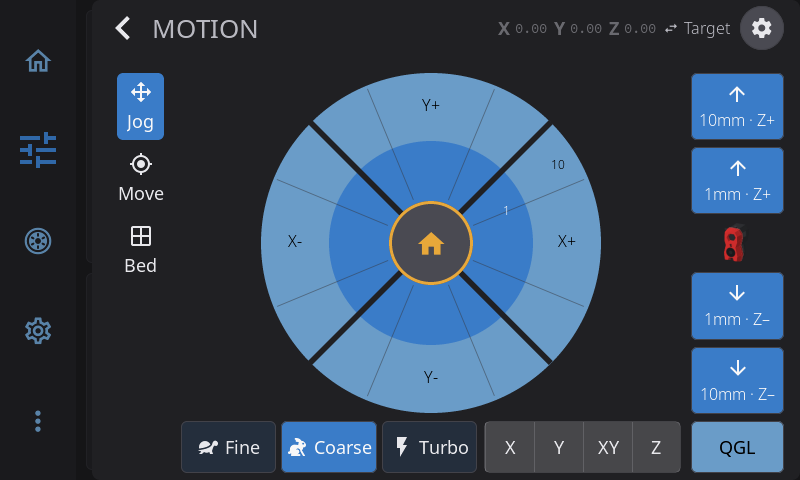
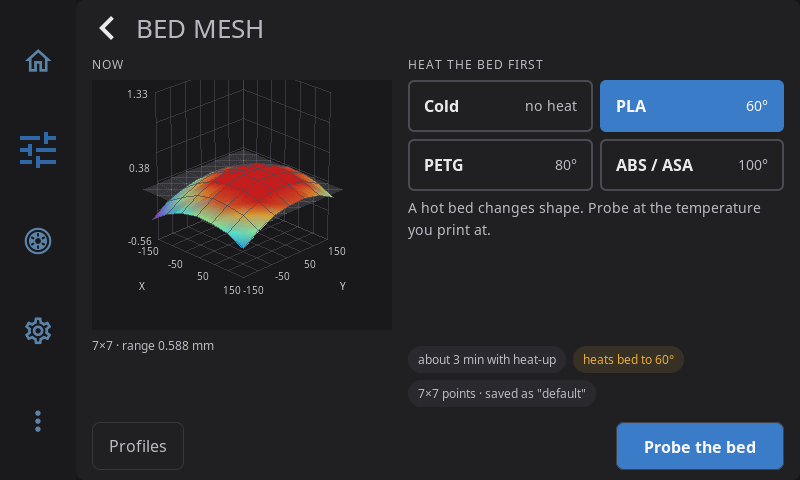

This guide covers everything you can do from HelixScreen's touchscreen. New to it? Start with [Getting Started](/guide/getting-started/), which tours the five navigation bar buttons and walks through the setup wizard. Looking for one thing? Find it in the table below or in the [Guide Contents](#guide-contents).

---

## I Want To...

| I want to... | Where on the screen | Read more |
|--------------|---------------------|-----------|
| Start a print | **Home**, then **Print Files** on the print card | [Printing](/guide/printing/) |
| Reprint my last file | **Home**, then **Reprint Last** on the print card | [Printing](/guide/printing/) |
| Pause or cancel a print | The buttons along the bottom of the print screen | [During a Print](/guide/printing/#during-a-print) |
| Change speed or flow mid-print | **Tune** on the print screen | [Print Tune Overlay](/guide/printing/#print-tune-overlay) |
| Fix my first layer | **Tune** on the print screen, or **Z-Offset** on **Controls** | [Z-Offset / Baby Steps](/guide/printing/#z-offset--baby-steps) |
| Stop printing one failed part | Press and hold the part in the print preview | [Exclude Object](/guide/printing/#exclude-object) |
| Watch the print on camera | A **Camera** widget, or **Settings > Devices > Camera** | [Camera](/guide/camera/) |
| Load or unload filament | **Filament** | [Filament Management](/guide/filament/#load--unload--purge) |
| Load a different slot or tool | **Filament**, then tap the slot | [The Filament System Panel](/guide/filament-ams-panel/) |
| Dry filament | **Filament**, then the temperature badge on a box, or **Advanced > Dry Filament** | [Filament Drying](/guide/filament-drying/) |
| Heat the nozzle or bed | **Controls**, or tap a heater on the Home screen | [Temperature Control](/guide/temperature/) |
| Move or home the print head | **Controls > Motion** | [Motion & Positioning](/guide/motion/) |
| Level my bed | **Controls > Bed Mesh**, or **Advanced > Bed Leveling** | [Calibration](/guide/calibration/#bed-mesh) |
| Tune input shaper | **Advanced > Input Shaping** | [Calibration](/guide/calibration/#input-shaper) |
| PID-tune a heater | **Advanced > Heater Calibration** | [Calibration](/guide/calibration/#heater-calibration-pid--mpc) |
| Run a macro | **Advanced > Macro Browser**, or a **Macros** widget | [Advanced Features](/guide/advanced/#macro-execution) |
| See past prints | **Advanced > Print History** | [Print History](/guide/print-history/) |
| Rearrange the home screen | Long-press the widget grid | [Edit Mode](/guide/home-edit-mode/) |
| Change the theme | **Settings > Appearance > Theme Colors** | [Appearance](/guide/settings/appearance/) |
| Join a Wi-Fi network | **Settings > Connection** | [Connection](/guide/settings/connection/) |
| Lock the screen with a PIN | **Settings > System > Security** | [Security & Screen Lock](/guide/security/) |
| Fix taps that land in the wrong spot | **Settings > Touch & Input > Touch Calibration** | [Touch Calibration](/guide/touch-calibration/) |
| Update HelixScreen | **Settings > Updates** | [Updates](/guide/settings/updates/) |

Something not working? See [Troubleshooting](/reference/troubleshooting/) and the [FAQ](/reference/faq/).

---

## Guide Contents

The guide follows how you use a printer day to day: your home screen, starting a job, watching it, and handling filament come first, then tuning and the things you set up once.

### Getting Started

- **[Getting Started](/guide/getting-started/)**: navigation, touch gestures, connection status, the first-run setup wizard, WiFi, and the on-screen keyboard.
- **[Supported Printers](/guide/supported-printers/)**: which printers get model-specific integration and what works on each.
- **[Installation](/installation/)**: installing HelixScreen on your printer or a Klipper host. To try it without touching the printer, [run it in a window on a Linux desktop](/guide/install-linux-desktop/).

### Your Home Screen

The home screen is yours to build: pick the widgets, size them, and spread them across pages.

- **[Home Panel](/guide/home-panel/)**: the status area, the widget grid, multiple pages, and emergency stop.
- **[Edit Mode](/guide/home-edit-mode/)**: adding, moving, resizing and configuring widgets, and adding pages.
- **[Widget Catalog](/guide/home-widgets/)**: every widget, with details on the [print](/guide/home-widgets-print/), [filament](/guide/home-widgets-filament/), and [control and system](/guide/home-widgets-controls/) widgets.
- **[Printer Manager](/guide/printer-manager/)**: your printer's name, model and picture, its software versions, and the hardware HelixScreen found.

### Starting a Print

- **[Choosing and starting a print](/guide/printing/)**: browsing files, the preview, pre-print options, checking the file fits the printer, queueing, and sending prints from OrcaSlicer.
- **[Filament Mapping](/guide/filament-mapping/)**: matching each color in a multi-color file to a slot before the print starts.
- **[Print History](/guide/print-history/)**: past jobs with statistics and trend charts, and reprinting a previous job.

### Watching the Current Print

- **[During a print](/guide/printing/#during-a-print)**: progress, pausing at a layer, the tune overlay, Z-offset baby steps, excluding a failed object, the post-print summary, and resuming after a power loss.
- **[Print Monitoring & Failure Detection](/guide/print-monitoring/)**: the pre-print filament check and the response to camera-based failure detection.
- **[Camera](/guide/camera/)**: the camera widget and the fullscreen viewer.
- **[Screen Sharing and Remote Control](/guide/screen-sharing/)**: seeing and using the printer's screen from any browser, or as a webcam in Mainsail and Fluidd.

### Filament

- **[Filament Management](/guide/filament/)**: load, unload and purge, extrusion controls, the external spool, and running more than one filament system.
- **[The Filament System Panel](/guide/filament-ams-panel/)**: slots, lanes, and per-unit controls for AMS-style systems (AFC, Happy Hare, ACE, IFS, QIDI Box, OpenAMS, and more).
- **[Creality Filament System (CFS)](/guide/filament-cfs/)** and **[Snapmaker U1 and MedusaHC](/guide/filament-tool-changers/)**: what is specific to those systems.
- **[Filament Drying and Humidity](/guide/filament-drying/)**: per-unit drying controls and humidity monitoring.
- **[Filament Tracking & Spoolman](/guide/filament-tracking/)**: how material, color and remaining weight are tracked, with the built-in tracker or a Spoolman server.

### Printer Control

- **[Temperature Control](/guide/temperature/)**: nozzle, bed and chamber targets, material presets, multiple extruders, and live graphs.
- **[Motion & Positioning](/guide/motion/)**: jogging, homing, tap-to-move, the bed map, parking, and emergency stop.
- **[Fans](/guide/fans/)**: speed control, RPM readouts, and renaming fans.
- **[Advanced Features](/guide/advanced/)**: the G-code console, macros, interactive prompts, power devices, notification history, and timelapse.

### Tuning & Calibration

- **[Calibration & Tuning](/guide/calibration/)**: bed mesh, screws tilt adjust, input shaper, Z-offset, tool offsets, belt tension, pressure advance, and PID tuning.

### Settings & Setup

- **[Settings](/guide/settings/)**: display, appearance and themes, touch, sound, printing, devices, safety, connection, language, updates, and more.
- **[Sensors](/guide/sensors/)**: filament runout and motion sensors, door and button inputs, and read-only sensors.
- **[Security & Screen Lock](/guide/security/)**: PIN lock, auto-lock, and what a factory reset clears.
- **[Touch Calibration](/guide/touch-calibration/)**: fixing taps that land in the wrong spot.
- **[HelixPrint Plugin](/guide/helixprint-plugin/)**: the optional Moonraker add-on, what it adds, and what works without it.
- **[Add-On Chamber Heater Setup](/guide/chamber-heater/)**: getting a BIGTREETECH Panda Breath working with Klipper.
- **[Bluetooth Setup](/guide/bluetooth-setup/)**: enabling Bluetooth on a Pi or BTT Pi, or adding a USB dongle.
- **[Barcode Scanner](/guide/barcode-scanner/)**: reading Spoolman QR codes with a USB or Bluetooth scanner.
- **[Label Printing](/guide/label-printing/)**: printing spool labels on Brother QL, Phomemo, Niimbot, or MakeID printers.

### More

- **[Tips & Best Practices](/guide/tips/)**: shortcuts, quick troubleshooting, and which panel to use for what.
- **[Beta Features](/guide/beta-features/)**: turning on beta features and choosing an update channel.
- **[Troubleshooting](/reference/troubleshooting/)**, **[FAQ](/reference/faq/)**, **[Configuration](/reference/configuration/)**, and **[Upgrading](/upgrading/)**.
- **[Creality K1C Setup](/guide/creality-k1c-setup/)**: rooting, community firmware, and installing HelixScreen on a K1, K1C or K1 Max.

---

*HelixScreen — Making Klipper accessible through touch*
